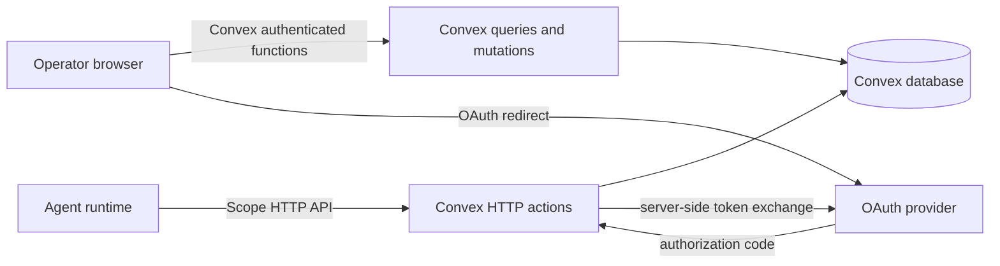
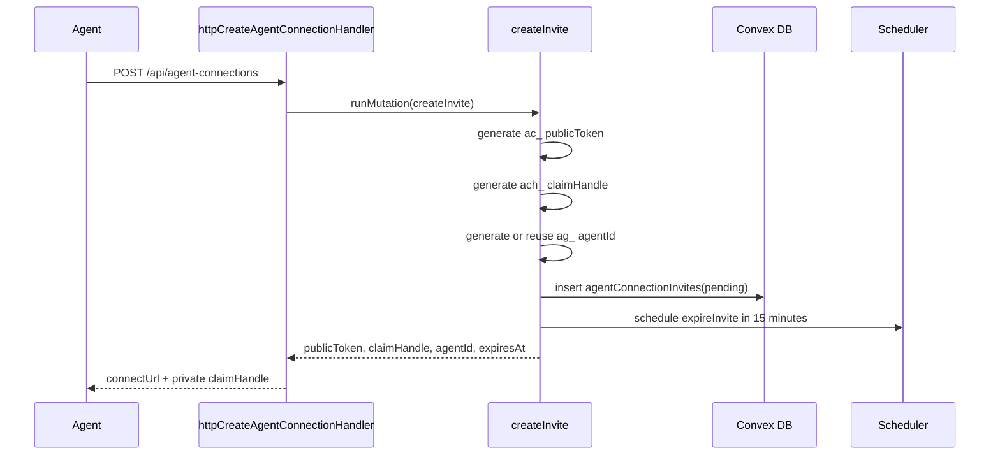
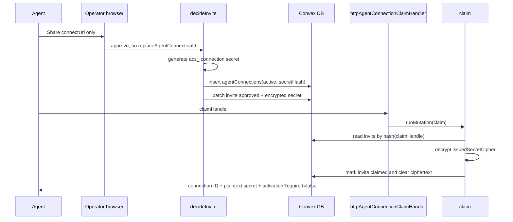
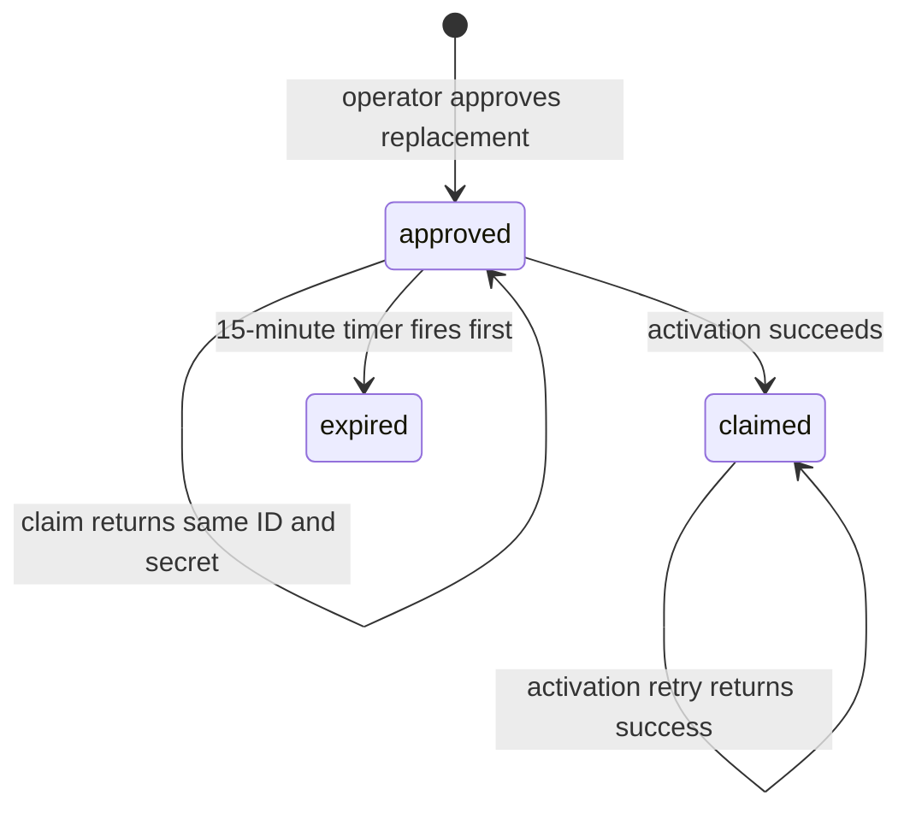
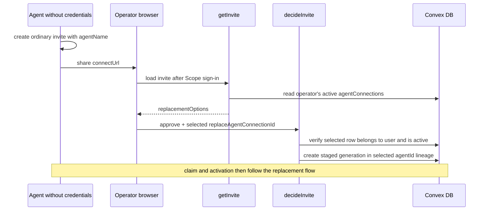
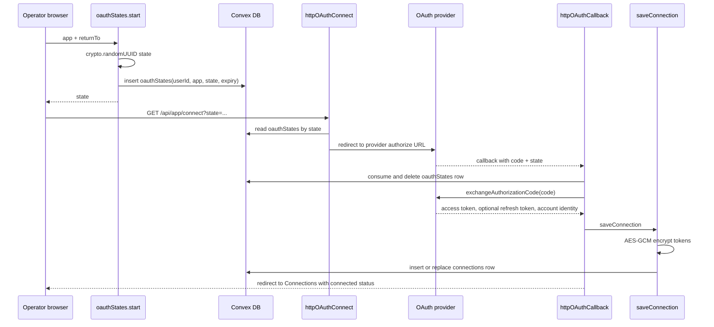
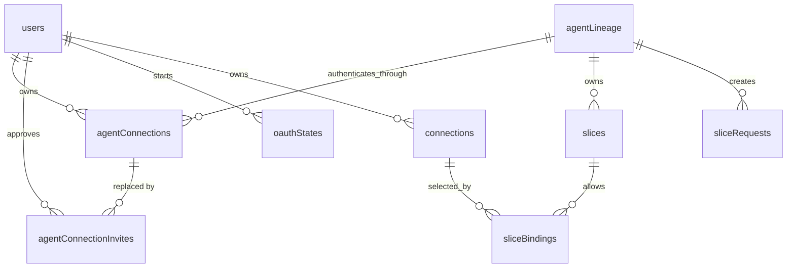

# Scope credential flows

This document traces the credentials used to connect an agent to Scope and to connect a provider account to Scope. It is written from the outside in: what the agent or browser sends, which Convex function runs, which database rows change, and where each secret exists at every point.

## System boundaries



The browser never receives an agent connection secret, an OAuth access token, or an OAuth refresh token. The agent receives an agent connection secret through the private claim flow. Drive, Docs, and Sheets bearer tokens stay in Convex: their slice credential API returns an opaque, agent-bound broker token for vetted operations. Other apps may issue freshly minted provider access tokens through the slice credential API.

## Source map

| Area                             | Main source                                                                                       |
| -------------------------------- | ------------------------------------------------------------------------------------------------- |
| HTTP route registration          | [`convex/http.ts`](../convex/http.ts)                                                             |
| Agent connection HTTP handlers   | [`convex/http/httpAgentConnectionHandlers.ts`](../convex/http/httpAgentConnectionHandlers.ts)     |
| Agent connection state machine   | [`convex/tables/agentConnections.ts`](../convex/tables/agentConnections.ts)                       |
| Connection approval UI           | [`components/agents/connect-agent.tsx`](../components/agents/connect-agent.tsx)                   |
| Database schema                  | [`convex/schema.ts`](../convex/schema.ts)                                                         |
| Secret generation and hashing    | [`convex/lib/secrets.ts`](../convex/lib/secrets.ts)                                               |
| AES-256-GCM encryption           | [`convex/lib/tokenEncryption.ts`](../convex/lib/tokenEncryption.ts)                               |
| OAuth browser entry and callback | [`convex/http/oauth.ts`](../convex/http/oauth.ts)                                                 |
| OAuth state lifecycle            | [`convex/tables/oauthStates/mutations.ts`](../convex/tables/oauthStates/mutations.ts)             |
| Provider implementations         | [`convex/oauth/providers/`](../convex/oauth/providers/)                                           |
| Provider token storage           | [`convex/tables/connections/mutations.ts`](../convex/tables/connections/mutations.ts)             |
| Connections dashboard            | [`components/connections/connections-table.tsx`](../components/connections/connections-table.tsx) |

### Function call index

| Function                                                                              | Called by                              | Calls or performs                                                            |
| ------------------------------------------------------------------------------------- | -------------------------------------- | ---------------------------------------------------------------------------- |
| [`httpCreateAgentConnectionHandler`](../convex/http/httpAgentConnectionHandlers.ts)   | `POST /api/agent-connections`          | `createInvite`                                                               |
| [`createInvite`](../convex/tables/agentConnections.ts)                                | Create HTTP handler                    | `activeAgentConnection`, secret generation, invite insert, expiry scheduling |
| [`getInvite`](../convex/tables/agentConnections.ts)                                   | `ConnectAgent` browser component       | Invite lookup and active replacement choices                                 |
| [`decideInvite`](../convex/tables/agentConnections.ts)                                | `ConnectAgent.submit`                  | Approval/denial, connection-secret generation, connection insert             |
| [`httpAgentConnectionStatusHandler`](../convex/http/httpAgentConnectionHandlers.ts)   | `POST /api/agent-connections/status`   | `claimStatus`                                                                |
| [`httpAgentConnectionClaimHandler`](../convex/http/httpAgentConnectionHandlers.ts)    | `POST /api/agent-connections/claim`    | `claim`                                                                      |
| [`claim`](../convex/tables/agentConnections.ts)                                       | Claim HTTP handler                     | Claim-handle lookup and staged-secret decryption                             |
| [`httpActivateAgentConnectionHandler`](../convex/http/httpAgentConnectionHandlers.ts) | `POST /api/agent-connections/activate` | `activateReplacement`                                                        |
| [`activateReplacement`](../convex/tables/agentConnections.ts)                         | Activation HTTP handler                | Secret verification and credential-generation swap                           |
| [`expireInvite`](../convex/tables/agentConnections.ts)                                | Convex scheduler                       | Invite expiry and unclaimed/staged connection revocation                     |
| [`oauthStates.start`](../convex/tables/oauthStates/mutations.ts)                      | Connections UI                         | OAuth state generation and insert                                            |
| [`httpOAuthConnect`](../convex/http/oauth.ts)                                         | `GET /api/:app/connect`                | State validation and `startAuthorize`                                        |
| [`startAuthorize`](../convex/oauth/index.ts)                                          | OAuth connect handler                  | Provider `authorize` implementation                                          |
| [`httpOAuthCallback`](../convex/http/oauth.ts)                                        | `GET /api/:app/callback`               | State consumption, code exchange, `saveConnection`                           |
| [`exchangeAuthorizationCode`](../convex/oauth/index.ts)                               | OAuth callback                         | Provider `exchange` implementation                                           |
| [`saveConnection`](../convex/tables/connections/mutations.ts)                         | OAuth callback                         | Token encryption and connection insert/replace                               |

## Credentials and identifiers

| Value                             | Generated by                                  | Database representation                                                                                                | Transmitted to                                           | Authority                                                                 |
| --------------------------------- | --------------------------------------------- | ---------------------------------------------------------------------------------------------------------------------- | -------------------------------------------------------- | ------------------------------------------------------------------------- |
| `publicToken` (`ac_…`)            | `createInvite` via `randomSecret("ac_")`      | Plaintext in `agentConnectionInvites.publicToken`                                                                      | Agent as part of `connectUrl`; operator through the link | Locates an invite. It does not approve or claim credentials.              |
| `claimHandle` (`ach_…`)           | `createInvite` via `randomSecret("ach_")`     | Only SHA-256 in `agentConnectionInvites.claimSecretHash`                                                               | Agent in the invite-creation response                    | Reads status and claims approved credentials. Must not be placed in chat. |
| `agentId` (`ag_…`)                | `createInvite` for a new lineage              | Plaintext on invites and connection generations                                                                        | Agent                                                    | Stable lineage identifier; not a secret.                                  |
| `agentConnectionId`               | Convex document ID from `ctx.db.insert`       | `_id` of `agentConnections`                                                                                            | Agent after claim                                        | Identifies one credential generation. Requires the matching secret.       |
| `agentConnectionSecret` (`acs_…`) | `decideInvite` via `randomSecret("acs_")`     | SHA-256 in `agentConnections.secretHash`; temporarily AES-GCM encrypted in `agentConnectionInvites.issuedSecretCipher` | Agent through claim only                                 | Authenticates an agent connection generation.                             |
| `TOKEN_ENCRYPTION_KEY`            | Operator, outside the app                     | Convex deployment environment only                                                                                     | Never transmitted by the app                             | Encrypts staged agent secrets and provider tokens at rest.                |
| OAuth `state`                     | `oauthStates.start` via `crypto.randomUUID()` | Plaintext, expiring `oauthStates` row                                                                                  | Browser and provider                                     | Single-use CSRF and callback correlation value.                           |
| OAuth authorization `code`        | Provider                                      | Not stored                                                                                                             | Provider redirects it to the Convex callback             | Single-use input to the server-side token exchange.                       |
| Provider client secret            | Provider console                              | Convex deployment environment only                                                                                     | Provider token endpoint, server to server                | Authenticates Scope's OAuth client.                                       |
| Provider access/refresh tokens    | Provider token endpoint                       | AES-GCM ciphertext in `connections`                                                                                    | Convex only                                              | Accesses or refreshes the connected provider account.                     |

`randomSecret` uses `crypto.getRandomValues` with 24 random bytes by default. `sha256Hex` stores one-way hashes for bearer secrets. `encryptToken` uses AES-256-GCM with a random 12-byte IV and the deployment's `TOKEN_ENCRYPTION_KEY`.

## Shared invite lifecycle

All three agent operations begin at `POST /api/agent-connections`, handled by `httpCreateAgentConnectionHandler`, which calls `createInvite`.



### State immediately after invite creation

| Holder                   | Holds                                                                                                    |
| ------------------------ | -------------------------------------------------------------------------------------------------------- |
| Agent                    | `connectUrl`, plaintext `claimHandle`, `agentId`, expiry                                                 |
| Operator/browser         | Only the `connectUrl` if the agent shares it                                                             |
| `agentConnectionInvites` | Plaintext `publicToken`, SHA-256 of `claimHandle`, `agentId`, requester-supplied name, `pending`, expiry |
| `agentConnections`       | No new row yet                                                                                           |

If active credentials were supplied, `createInvite` first calls `activeAgentConnection`. That function reads the supplied `agentConnectionId`, requires `status === "active"`, hashes the supplied secret, and compares it with `secretHash`. A revoked or staged generation cannot create a rotation invite.

The browser opens `/connect/[publicToken]`. `ConnectAgent` calls the authenticated `getInvite` query. `getInvite` reads `agentConnectionInvites` by `by_public_token`. Owner-bound rotation links return `null` to another user. Ordinary links also read the signed-in user's active `agentConnections` rows so the UI can offer connect-as-new or replacement choices.

The agent can poll `POST /api/agent-connections/status`. `httpAgentConnectionStatusHandler` calls `claimStatus`, which hashes the supplied `claimHandle`, reads the invite through `by_claim_secret_hash`, and returns only status and expiry.

## Connect as new

Connect-as-new creates a new lineage with no inherited slices.



### Approval transaction

`ConnectAgent.submit` calls `decideInvite` with `decision: "approved"` and no `replaceAgentConnectionId`.

`decideInvite`:

1. Reads the `agentConnectionInvites` row by `publicToken`.
2. Requires `pending`, unexpired, and, when already bound, the same `userId`.
3. Generates `agentConnectionSecret` with `randomSecret("acs_")`.
4. Inserts an `agentConnections` row with:
   - the verified operator's `userId`;
   - the invite's new `agentId`;
   - `secretHash = sha256Hex(agentConnectionSecret)`;
   - `status = "active"`.
5. Patches the invite to `approved`, attaches the verified `userId` and new connection ID, and stores `encryptToken(agentConnectionSecret)` in `issuedSecretCipher`.

### Claim transaction

`httpAgentConnectionClaimHandler` accepts the private `claimHandle` and calls `claim`.

For a new connection, `claim` decrypts `issuedSecretCipher`, marks the invite `claimed`, clears the ciphertext, and returns the plaintext secret once. After a successful claim, the database retains only `agentConnections.secretHash`; the plaintext secret should exist only in the agent's secure storage.

### State after claim

| Holder                   | Holds                                                                             |
| ------------------------ | --------------------------------------------------------------------------------- |
| Agent                    | Stable `agentId`, active `agentConnectionId`, plaintext `agentConnectionSecret`   |
| Browser                  | No connection secret                                                              |
| `agentConnections`       | Active row with SHA-256 secret hash                                               |
| `agentConnectionInvites` | `claimed`; empty `issuedSecretCipher`; claim-handle hash remains as spent history |
| Slices                   | None inherited; the agent must request them separately                            |

If a new-connection claim never arrives, `expireInvite` revokes the newly created connection and clears its encrypted secret at the 15-minute expiry.

## Claim behavior for replacements

Rotation and lost-credential reconnect both create a replacement. Their claims are deliberately retryable.



For a replacement, `claim` decrypts and returns `issuedSecretCipher` but does **not** clear it or change the invite from `approved`. If the HTTP response is lost, the agent retries with the same `claimHandle` and receives the same connection ID and secret. The response includes `activationRequired: true`.

The plaintext replacement secret exists transiently inside the Convex mutation and HTTP response. At rest it exists as:

- SHA-256 in the staged `agentConnections.secretHash` field; and
- AES-GCM ciphertext in `agentConnectionInvites.issuedSecretCipher` until activation or expiry.

## Activation

Activation proves the agent received and retained the replacement secret.

```mermaid
sequenceDiagram
  participant A as Agent
  participant H as httpActivateAgentConnectionHandler
  participant M as activateReplacement
  participant D as Convex DB

  A->>H: POST /api/agent-connections/activate<br/>replacement ID + replacement secret headers
  H->>M: runMutation(activateReplacement)
  M->>D: read replacement agentConnections row
  M->>M: hash and compare replacement secret
  M->>D: read invite by replacement connection ID
  M->>D: read current active generation
  M->>D: revoke current; activate replacement
  M->>D: mark invite claimed; clear encrypted secret
  M-->>A: active
```

`activateReplacement` performs one Convex transaction:

1. `agentConnectionBySecret` reads the replacement row and verifies the supplied secret hash.
2. If the row is already `active`, it returns success. This makes activation idempotent after a lost response.
3. Otherwise it requires `status === "staged"`.
4. It reads the invite through `agentConnectionInvites.by_agent_connection_id` and requires `approved`, unexpired, and a `replacesAgentConnectionId`.
5. It reads the previous generation and requires it still be `active`.
6. It marks the previous generation `revoked` and the replacement `active`.
7. It marks the invite `claimed` and clears `issuedSecretCipher`.

No slice or slice-request rows are read or written during activation. They carry the stable `agentId`, so the credential swap cannot change their ownership or origin.

The previous credentials remain usable until step 6 commits. The replacement credentials cannot authenticate ordinary agent operations while their row is `staged`, because `activeAgentConnection` requires `active`.

If activation never happens, `expireInvite` revokes the staged row and clears the encrypted replacement secret. It does not modify the previous active generation, its slices, or its pending requests.

## Planned rotation

Rotation applies when the agent still has valid credentials and wants a new credential generation.

### Timeline and holdings

| Step              | Agent holds                                          | Database holds                                                                                     |
| ----------------- | ---------------------------------------------------- | -------------------------------------------------------------------------------------------------- |
| Before rotation   | Current connection ID and secret                     | Current `agentConnections` row is `active`; slices and requests carry the lineage `agentId`        |
| Create invite     | Current credentials, new `claimHandle`, `connectUrl` | Pending invite is already bound to current `userId`, `agentId`, and `replacesAgentConnectionId`    |
| Operator approves | Current credentials and `claimHandle`                | Current remains `active`; replacement row is `staged`; replacement secret is hashed and encrypted  |
| Agent claims      | Current credentials plus replacement ID and secret   | Same staged replacement; encrypted secret retained for claim retry                                 |
| Agent activates   | Replacement ID and secret                            | Lineage records are unchanged; old row is `revoked`; new row is `active`; encrypted secret cleared |

### Call chain

1. Agent sends current credentials in `x-agent-connection-id` and `x-agent-connection-secret` to `httpCreateAgentConnectionHandler`.
2. `httpCreateAgentConnectionHandler` calls `createInvite`.
3. `createInvite` calls `activeAgentConnection`, reuses the current `agentId`, name, and owner, and records the current row in `replacesAgentConnectionId`.
4. Because the invite already carries `userId`, `getInvite` hides it from every other signed-in user.
5. `decideInvite` does not permit the browser to change the rotation target.
6. Claim and activation follow the replacement behavior described above.

Revoked credentials fail at step 3. They cannot create a rotation invite or restore their lineage.

## Lost-credential reconnect

Reconnect applies when the agent no longer has its connection ID or secret, but the operator still has an active connection for that agent.



The unauthenticated agent cannot prove which lineage it previously belonged to. `createInvite` therefore creates a new provisional `agentId`. The authoritative binding happens only when the verified operator selects an active connection in the UI:

- `getInvite` returns active rows owned by `ctx.userId` as `replacementOptions`.
- `ConnectAgent` sends the chosen ID as `replaceAgentConnectionId`.
- `decideInvite` reads that row and requires the same verified `userId` and `status === "active"`.
- The selected row's stable `agentId` and name replace the invite's provisional values.

Revoked rows are absent from `replacementOptions`. If the operator chooses “Connect as a new agent,” no old lineage or slices are inherited.

## Denial, cancellation, and expiry

| Event                                     | Function                                                  | Database result                                          | Existing connection result         |
| ----------------------------------------- | --------------------------------------------------------- | -------------------------------------------------------- | ---------------------------------- |
| Operator denies                           | `decideInvite`                                            | Invite becomes `denied`; verified `userId` is recorded   | Unchanged                          |
| Agent cancels before approval             | `httpCancelAgentConnectionInviteHandler` → `cancelInvite` | Pending invite becomes `expired`; expiry set to now      | Unchanged                          |
| Pending invite expires                    | Scheduler → `expireInvite`                                | Invite becomes `expired`                                 | Unchanged                          |
| Approved new connection expires unclaimed | Scheduler → `expireInvite`                                | New connection becomes `revoked`; ciphertext cleared     | No previous generation             |
| Approved replacement expires unactivated  | Scheduler → `expireInvite`                                | Staged replacement becomes `revoked`; ciphertext cleared | Previous generation remains active |

## OAuth client registration

Scope does not create provider OAuth clients through code. A developer creates each client in the provider's console, registers callback URLs, and places its credentials in the Convex deployment environment.

| Provider | Environment variables                          | Callback                                                                                          |
| -------- | ---------------------------------------------- | ------------------------------------------------------------------------------------------------- |
| GitHub   | `GITHUB_CLIENT_ID`, `GITHUB_CLIENT_SECRET`     | `/api/github/callback`                                                                            |
| Google   | `GOOGLE_CLIENT_ID`, `GOOGLE_CLIENT_SECRET`     | One callback each for `/api/gmail`, `/api/calendar`, `/api/drive`, `/api/docs`, and `/api/sheets` |
| Slack    | `SLACK_CLIENT_ID`, `SLACK_CLIENT_SECRET`       | `/api/slack/callback`                                                                             |
| Airtable | `AIRTABLE_CLIENT_ID`, `AIRTABLE_CLIENT_SECRET` | `/api/airtable/callback`                                                                          |
| Notion   | `NOTION_CLIENT_ID`, `NOTION_CLIENT_SECRET`     | `/api/notion/callback`                                                                            |
| Linear   | `LINEAR_CLIENT_ID`, `LINEAR_CLIENT_SECRET`     | `/api/linear/callback`                                                                            |
| Vercel   | `VERCEL_CLIENT_ID`, `VERCEL_CLIENT_SECRET`     | `/api/vercel/callback`                                                                            |
| Zoom     | `ZOOM_CLIENT_ID`, `ZOOM_CLIENT_SECRET`         | `/api/zoom/callback`                                                                              |

`oauthCallbackUrl` builds each full callback from the private Convex `CONVEX_SITE_URL`. `oauthConfigured` reports only whether each provider's required environment values are nonempty. Provider client secrets are never written to a Convex table or returned to the browser.

The provider dispatch entries are the exported `ProviderOAuth` objects [`github`](../convex/oauth/providers/github.ts), [`google`](../convex/oauth/providers/google.ts), [`slack`](../convex/oauth/providers/slack.ts), [`airtable`](../convex/oauth/providers/airtable.ts), [`notion`](../convex/oauth/providers/notion.ts), [`linear`](../convex/oauth/providers/linear.ts), [`vercel`](../convex/oauth/providers/vercel.ts), and [`zoom`](../convex/oauth/providers/zoom.ts). Each implements `authorize`, `exchange`, `refresh`, and `revoke` as defined by [`ProviderOAuth`](../convex/oauth/types.ts).

## Connecting an OAuth account

This is the runtime flow that uses a registered OAuth client to create or replace a `connections` row.



### Start in the browser

`ConnectionsTable.connect` calls the authenticated `oauthStates.start` mutation with the chosen app and `/connections` return URL. `start`:

1. Uses the authenticated `ctx.userId`; it never accepts a user ID from the browser.
2. Generates a UUID `state`.
3. Inserts an `oauthStates` row with a 10-minute expiry and a validated same-origin `returnTo`.
4. Returns the state to the browser.

The browser appends `state` to `APP_CONNECT_URL[app]` and navigates to the Convex HTTP origin.

### Authorization redirect

`httpOAuthConnect(app)`:

1. Reads the state from the URL.
2. Calls `oauthStates.queries.get` and requires the row to exist, be unexpired, and match the route's app.
3. Calls `startAuthorize`, which dispatches to the provider's `authorize` implementation in `PROVIDER_OAUTH`.
4. Redirects the browser to the provider.

The provider client ID, requested scopes, callback URL, and state normally appear in this authorization URL. The provider client secret does not.

### Callback and token exchange

`httpOAuthCallback(app)`:

1. Reads `code`, `state`, or provider error parameters from the callback URL.
2. Calls `oauthStates.mutations.consume`. `consume` reads and immediately deletes the state row, then rejects it if expired. This makes state single-use.
3. Calls `exchangeAuthorizationCode`, which dispatches to the provider's server-side `exchange` implementation.
4. The provider exchanges the short-lived authorization code using the provider client credentials from Convex environment variables.
5. The provider implementation returns an `OAuthGrant`: access token, optional refresh token, expiry, display login, and stable provider account ID.
6. The callback calls `saveConnection`.

The authorization code and raw token response are not stored in the database. They exist only during the callback action and provider exchange.

### Provider token storage

`saveConnection`:

1. Requires a stable `providerUserId` and validates that the provider matches the app.
2. Reads an existing row through `connections.by_user_app_providerUserId`.
3. Encrypts the access token with `encryptToken`.
4. Encrypts the refresh token when supplied; otherwise it preserves the existing encrypted refresh token during reconnection.
5. Inserts or replaces the `connections` row.

### State after OAuth connection

| Holder             | Holds                                                                                                                                           |
| ------------------ | ----------------------------------------------------------------------------------------------------------------------------------------------- |
| Browser            | Connected/denied/error result in the return URL; no provider tokens                                                                             |
| Provider           | Its own grant and account state                                                                                                                 |
| `oauthStates`      | No row; it was consumed and deleted                                                                                                             |
| `connections`      | Owner `userId`, app, display login, stable provider account ID, encrypted access token, optional encrypted refresh token, optional token expiry |
| Convex environment | Provider client ID and secret; `TOKEN_ENCRYPTION_KEY`                                                                                           |

Provider account display email or username is never used to resolve Scope ownership. The `connections.userId` came from the authenticated OAuth-state row created before the redirect.

## Database relationship summary



`agentLineage` is conceptual rather than a separate table; its key is `agentId`. That ownership key is shared by connection generations, slices, and slice requests. `agentConnectionId` identifies only one credential generation. Replacement activation changes which generation can authenticate the lineage without rewriting any grant or request.
