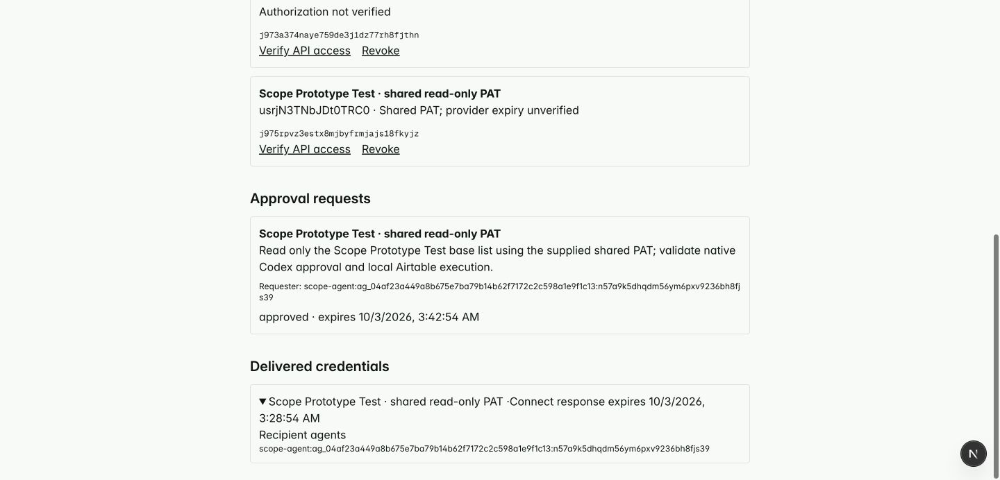
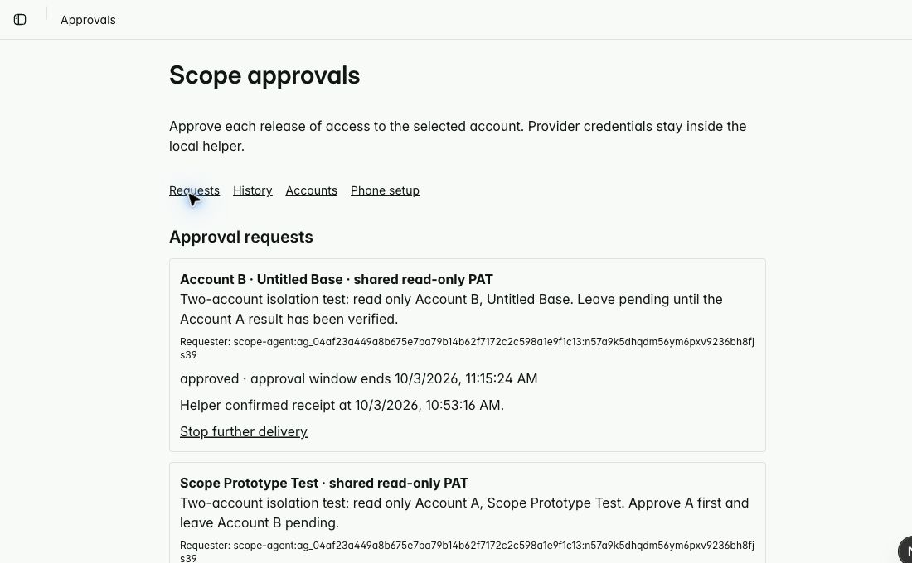
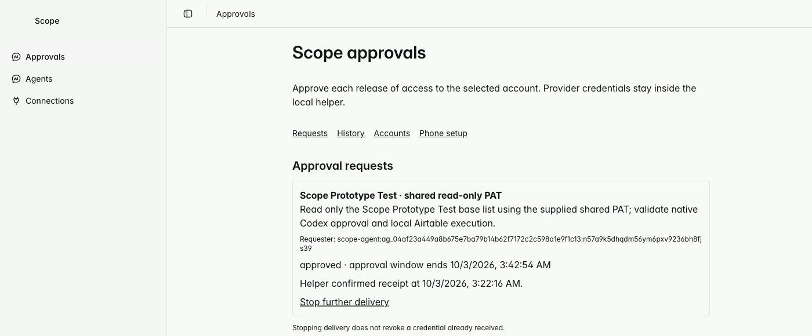
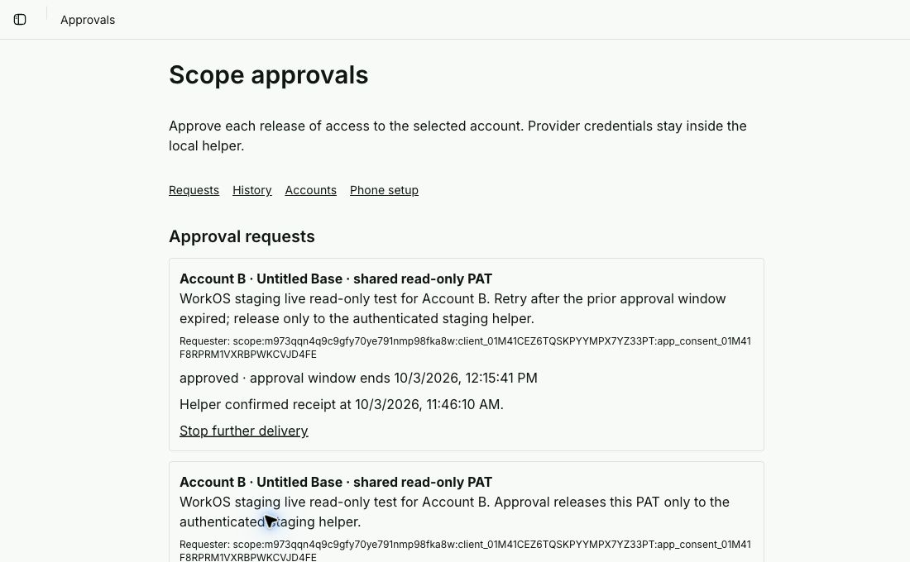
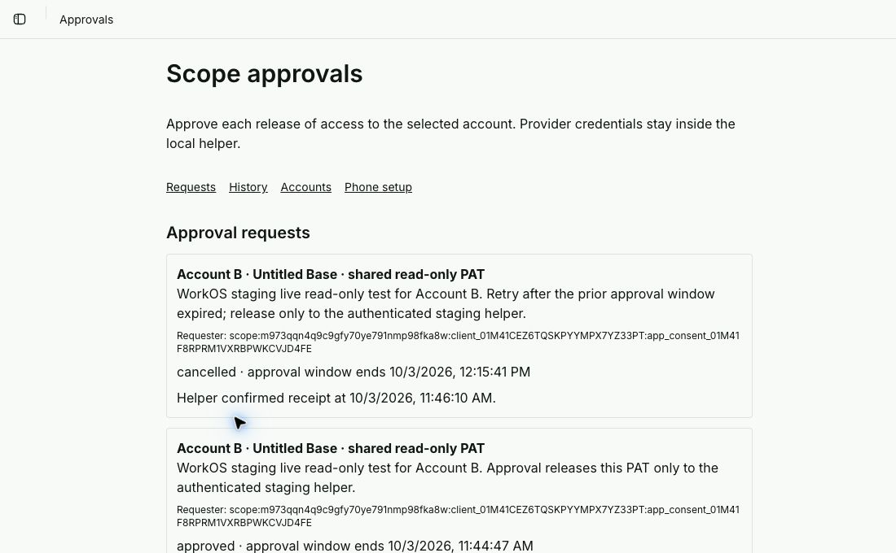
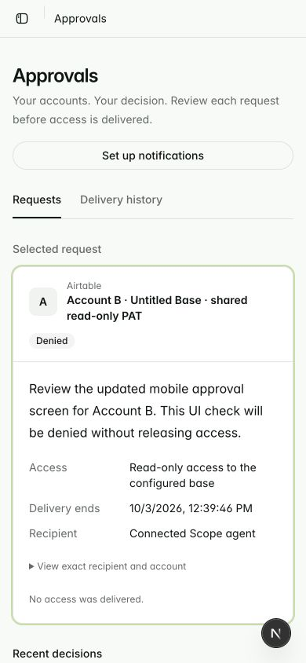
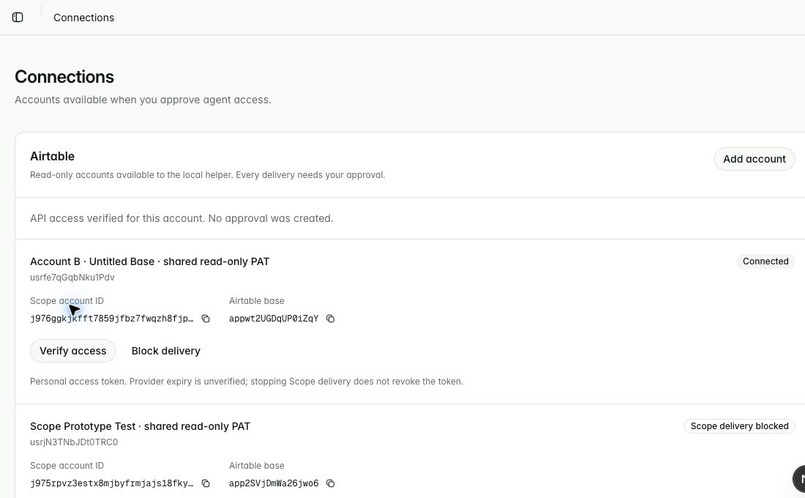
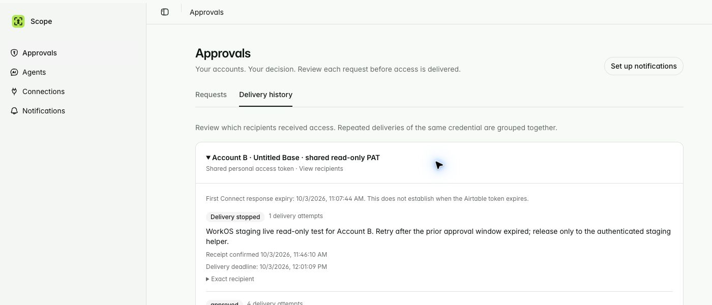
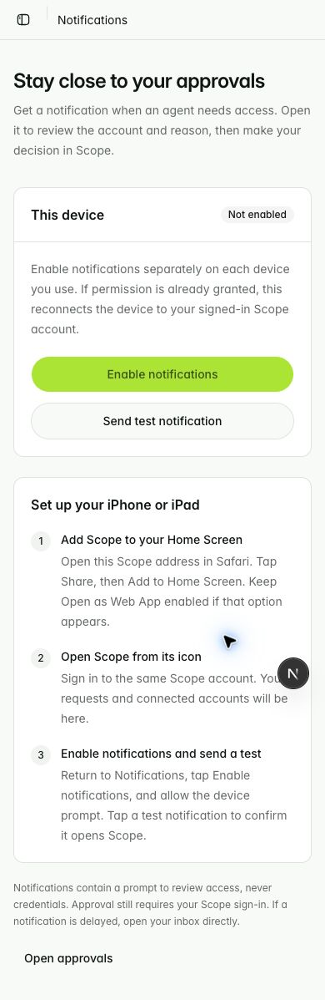
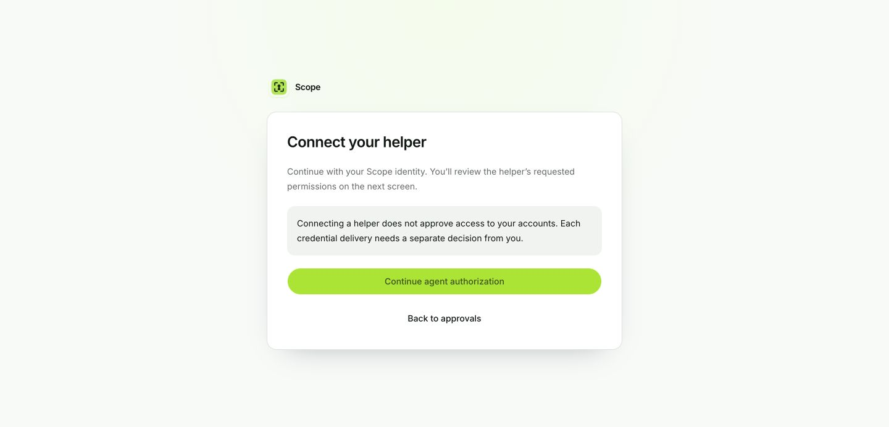

# Scope approval experiments

Experimental branch: `codex/scope-approval-prototypes`, based exactly on cleanup commit `9ac1df0`. The cleanup is [PR 48](https://github.com/nishilfaldu/scope/pull/48), targeting main and left unmerged. The implemented approval flow lives at `/lab`, linked as **Approvals** in the actual Scope sidebar. It uses separate tables while the verified Slack flow remains available. The original checkout is the only active checkout.

## Live read-only PAT test

Continue in the single shared checkout `/Users/happyhome/Desktop/agent-passport`. Inspect the current branch and changes before editing; switch branches here rather than creating worktrees.

The user supplied `airtable/scope-prototype-read-only` (`scl_KfyFWYC864MEEK9JTdDRQ`), a shared app-subject PAT connector bound to development and preview only. The dedicated base is `app2SVjDmWa26jwo6`, **Scope Prototype Test**. Real `getTokenResponse(..., { subject: { type: "app" } })` retrieval succeeded. Private calls to Airtable's `whoami` and `bases` endpoints both returned HTTP 200, and the credential exposed exactly that one base. No provider token was printed or saved locally.

Connect supplies an `expiresAt` value even for this connector. The probe preserves that as the **Connect response expiry**, while marking the PAT's provider expiry as unverified (`providerExpiresAt: null`). This is not evidence of OAuth refresh, short-lived provider tokens, or two-account isolation. The helper rejects an unexpected base or extra base results.

This test uses the existing Scope agent-connection authentication instead of WorkOS. Run `node prototypes/pair-existing-auth.mjs` from the repo, then approve the named agent through Scope's existing pairing page. The script privately claims, saves and acknowledges the connection; model-visible output contains only the approval URL and completion status. The helper keeps the agent credential in its private configuration, and sends it only to Scope. The server validates that connection's active state and derives its owner; a client-supplied owner is never accepted.

The server requires `SCOPE_PAT_TEST_OWNER_ID`, pinned to the existing test owner, and the nonsecret named bindings in `config/airtable-pat-bindings.json`. Each entry binds one connector to one expected base; raw PATs remain in Vercel Connect. `CONNECT_AIRTABLE_PAT_CONNECTOR` is no longer used. Choose a configured read-only test account in `/lab`, then invoke the actual Codex `airtable_list_bases` tool with its account ID. Registration accepts only the binding key, verifies its exact base scope, and reuses the matching active account on repeated registration. Approve the access request in `/lab`. Both approval and provider-data delivery must be observed before calling the full test successful. The “Revoke” control for this shared PAT blocks Scope delivery only; it deliberately does not revoke the shared connector for other uses.

**The real end-to-end test passed.** The human reported receiving the notification on their iPhone and approving the actual request. The outstanding native Codex `airtable_list_bases` call then returned `Scope Prototype Test` (`app2SVjDmWa26jwo6`), with no provider token in its result. A native same-key retry returned the same base and expiry; Scope showed one credential history row. This is separate from the earlier SDK timing simulation.

The request is `k578yh42hj91z5rv41rrxskf9d8fjcss`, key `pat-live-native-20261003-01`. During setup, an authenticated diagnostic created the pending request after the already-running helper used its older Bearer authentication format. The server now accepts that existing Scope credential envelope as well as the new helper's connection headers. The native call reused the pending request and completed after phone approval. No user identity or provider credential was fabricated.

After hardening the implementation, the updated helper was additionally run through the official MCP SDK against the **same real approval**. It returned the same base, explicitly reported `providerExpiresAt: null`, confirmed its receipt in Scope, and emitted zero stderr bytes. This additional run proves the new receipt path; the original native call is the proof of desktop-tool continuation. The older process loaded in this chat did not exercise the new PAT-specific checks; those were exercised by the updated helper and fixtures.

The returned `permissionLevel` field is included unchanged as Airtable metadata. The operation only read identity and base metadata. No write operation or provider-expiry/refresh experiment was performed.



## Two-account PAT implementation and live proof

The server map now contains two real, separately owned Airtable accounts:

| Binding       | Connect connector           | Expected base                              | Verified provider identity |
| ------------- | --------------------------- | ------------------------------------------ | -------------------------- |
| `prototype-a` | `scl_KfyFWYC864MEEK9JTdDRQ` | `app2SVjDmWa26jwo6` · Scope Prototype Test | `usrjN3TNbJDt0TRC0`        |
| `prototype-b` | `scl_pT19xygPR0LeNnCxDiIA`  | `appwt2UGDqUP0iZqY` · Untitled Base        | `usrfe7qGqbNku1Pdv`        |

Private preflight calls returned HTTP 200 for both identities and base lists, each exposing exactly its expected base. The owner registered B through the actual Scope UI. Both real requests were then created through the native Codex tool. After the human approved A on their phone, A returned its base while a same-key B call still returned `pending`. Only after the human separately approved B did B return its own base and distinct provider identity. Requests: A `k57cbbk153bkex7158tx3zbcxs8fj5jq`, B `k573n25wzabe4snp1y1tnqqnv98fj9fw`; retry keys `two-pat-live-A-20261003-01` and `two-pat-live-B-20261003-01`.

Fresh installed-helper runs through the official MCP SDK reused those same approvals, returned the correct bases with PAT-specific validation/expiry labels, confirmed receipt for each in Scope, and emitted zero stderr bytes. The native process already loaded in this chat returned the older result format; it proves the native round trip, while the fresh helper runs prove the current implementation. Credentials were not returned to the model.

Owner pinning, exact connector/base pairing, separate approvals, and authenticated recipient checks remain enforced. Automated tests additionally reject a wrong owner, swapped connector/base, substituted provider identity, extra base, removed binding on cached delivery, and another authenticated recipient. Both requests in that first pass used the same existing Scope agent connection. The subsequent WorkOS pass below adds live authentication and a second real recipient check. No schema or migration was needed for this extension.



## Implemented after the live proof

- Requests bind the authenticated recipient, selected account, reason and idempotency key. Account/provider/installation bindings cannot be silently replaced after verification. Only the authenticated owner plus the private server bridge can confirm bindings.
- Existing Scope agent authority is checked in each request/delivery transaction, including after provider acquisition. Revocation or cancellation during the external call fences delivery. WorkOS JWT verification and separately approved provider delivery are live-tested against the stable preview.
- Each request has a fixed approval window and its own encrypted replay payload/deadline. Exact token fingerprints group history without sharing or extending another request's delivery expiry. New history rows contain no ciphertext. Scheduled cleanup removes expired delivery ciphertext, preserving decisions and nonsecret history.
- The helper acknowledges receipt after validation and before provider work. Scope preserves first-attempt and receipt timestamps separately. Receipt means receipt into the helper process, not durable local token storage or completed Airtable work. Retries remain possible within the original deadline.
- The app has an approval inbox, cancellation, paginated history and per-credential recipient pagination. Push links target the request. PAT expiry and local blocking are labeled separately from provider revocation.
- Request creation atomically schedules one notification job per saved subscription. Jobs use leases, crash recovery, bounded retries and 404/410 subscription cleanup. Provider errors are never logged. A failed notification does not lose the approval request.

Removed/replaced: synchronous push sending from request handlers, encrypted-token storage in newly created history rows, history recipient discovery limited to the latest 100 requests, mutable installation confirmation, and the ambiguous PAT expiry/revocation labels. The manual test-push endpoint remains for setup.

Existing agent pairing, Slack slices and their regression tests are retained: both existing Scope authentication and WorkOS staging authentication are proven through real PAT delivery. Live multi-account OAuth remains unverified. No legacy-data migration is required; the user explicitly permits deleting development data. No idle-chat wakeup, custom launcher, Dots integration, production rollout or PR merge was added.



## Live WorkOS and Scope-blocking checks

On October 3, 2026, the registered staging helper followed WorkOS authorization to the stable preview, used Scope's existing email-code sign-in, and received explicit human consent for identity/profile/email access. The authorization-code/PKCE exchange saved a WorkOS access token privately. The local callback completed even though Chrome displayed a blocked callback page. Neither a provider token nor the WorkOS token was printed. The original helper's Scope agent configuration is preserved; this test uses a separate mode-0600 `workos-test.json` configuration.

The first authenticated MCP call exposed the Standalone subject-mapping bug described above. After the fix, the real signed token mapped to the correct Scope owner, and the deployed remote MCP endpoint completed initialization, listed `request_approval`, and created separate A/B requests. The same existing consent was reused on another login without broadening permissions. This is repeated sign-in, not an OAuth refresh-token test; the prototype login does not retain refresh tokens.

- A (`k5716vnz3fs9ytg3x9291hwmjs8fje79`, key `workos-cancel-A-20261003-01`) was denied through the actual UI without releasing a PAT. The helper returned `denied` on the same key.
- B (`k5728j0jn1z1v85pseg4hxrem98fk8db`, key `workos-live-B-20261003-01`) initially returned `pending` with no token. A different real authenticated recipient, the existing Scope agent connection, received HTTP 400 for B's request and no credential. The human later approved B, but collection happened after its original approval deadline; the helper correctly returned `expired`.
- The human separately approved fresh B request `k57baqv0zfwttvf4x7psz4jnvx8fkm8j` (key `workos-live-B-20261003-02`). The installed helper, launched through the official MCP SDK with the real WorkOS token, returned B's expected identity `usrfe7qGqbNku1Pdv` and base `appwt2UGDqUP0iZqY` (Untitled Base). Scope recorded helper receipt at 11:46:10 AM Pacific. Output contained provider data and nonsecret expiry metadata, no credential; stderr was empty.
- Clicking **Stop further delivery** on that approved B request changed it to `cancelled`. The same helper/key then returned `cancelled` with no credential and empty stderr. B's account remains active; this cancelled only the specific approval.
- The UI's **Block future delivery** control was exercised on A (`j975rpvz3estx8mjbyfrmjajs18fkyjz`). New A requests were rejected while B remained independently pending. A private Connect/Airtable `whoami` check after the block returned HTTP 200 for A's expected identity: the PAT remains active at the provider. No provider-side revocation was attempted.

A is intentionally left blocked in Scope after this test. The underlying connector is untouched. Re-registering the configured A binding creates a new account record whose future deliveries require fresh approval. The account status label says **Scope delivery blocked**, avoiding an ambiguous claim that the PAT itself was revoked.

The agreed PAT flow is complete with no remaining human approval step. This WorkOS proof uses the installed helper through the official MCP SDK; the earlier native Codex tool proof used existing Scope agent authentication. Native remote Codex OAuth sign-in has not been tested. PATs do not exercise Airtable OAuth refresh or provider revocation; those require an OAuth setup or an explicit provider-side revocation experiment and do not block the current PAT flow.





## Integrated Scope UI (October 3, 2026)

The working flow now uses Scope’s existing Inter typography, green accents, shared buttons/badges/dialogs and sidebar. `/approvals` separates open requests, recent decisions and paginated delivery history. Requests show the account, reason, delivery window, exact recipient details and receipt state. Expired approvals no longer say they are waiting for collection. A direct owner-checked request lookup opens notification targets beyond the first history page without exposing delivery ciphertext, leases or receipt secrets.

Airtable accounts now live in Connections alongside the existing Slack path. Account IDs and base IDs remain copyable for helper setup. Verification, configured PAT registration and delivery blocking remain available; the OAuth path is retained under connection options. `/notifications` explains Home Screen installation and device permissions, detects unsupported/blocked states, reuses existing subscriptions, and distinguishes push-service acceptance from physical receipt. `/authorize-agent` presents the WorkOS continuation only when sign-in is initiated.

Removed: the monolithic lab UI, its unstyled controls and anchors, the always-visible agent sign-in control, and the “Scope Approval Lab” installed-app name. Compatibility retained: `/lab` redirects request/account/WorkOS query parameters, the registered WorkOS external-login address is unchanged, `/probe-sw.js` keeps existing phone subscriptions valid, and the manifest’s explicit `/lab` identity preserves existing installations while its start URL moves to `/approvals`. API/plugin/configuration identifiers remain unchanged because the installed helper and existing integrations still use them. No provider or legacy Slack/pairing implementation was removed.

Validation on `http://localhost:3000` used the existing sign-in and real development data. The 390 px phone layout displayed request `k571e3vch86fbwhsq138mrpn4s8fjqf6`; tapping Deny made a native helper retry with key `scope-ui-review-B-20261003-01` return `denied` without a credential. Connections verified B’s API access while A stayed blocked. The notification test was accepted for one existing subscribed device; physical receipt was not re-confirmed in this pass. Mobile history and connections had no horizontal overflow. The mobile check also exposed and fixed an existing sidebar hydration mismatch using a consistent server snapshot.

The deployed authorization screen completed another real WorkOS PKCE sign-in using existing consent. A same-key call through the installed helper still refused the cancelled B delivery. The original helper configuration remains intact.

New automated checks cover owner-only deep links and secret exclusion, terminal/expired approval actions, legacy redirects, iPhone installation gating, denied notification permission, existing subscription reuse, worker activation timeout, safe notification destinations and the mobile hydration snapshot. This pass checks desktop Chrome at a phone viewport and installation logic; it does not claim a new physical iPhone installation test. Installation guidance follows [WebKit’s Home Screen push requirements](https://webkit.org/blog/13878/web-push-for-web-apps-on-ios-and-ipados/) and [WebKit’s Open as Web App guidance](https://webkit.org/blog/17333/webkit-features-in-safari-26-0/).











## Earlier prototype evidence (before the live PAT test)

| Experiment           | Observed result                                                                                                                                                                                                                               | Still unverified                                                                         |
| -------------------- | --------------------------------------------------------------------------------------------------------------------------------------------------------------------------------------------------------------------------------------------- | ---------------------------------------------------------------------------------------- |
| Cleanup baseline     | 95 tests, typecheck, lint, formatting and Next build passed before commit/push                                                                                                                                                                | Human PR review and merge                                                                |
| Prototype boundaries | 104 tests passed, including JWT signature/issuer/audience/expiry checks, ownership, requester binding, independent account approvals, conflicting retries, denial, acquisition leases, revocation during acquisition and shared-token history | Real WorkOS-issued tokens                                                                |
| Private local helper | Three fixture checks passed: only fixed Airtable endpoints receive provider bearer credentials; pending retries retain the key; wrong account, expired grant and credential echo fail closed                                                  | Actual Airtable API token via Connect                                                    |
| MCP wire timing      | Installed helper launched through the official MCP SDK; 10-second and 90-second approvals completed, and a 60-second client timeout recovered after approval at 90 seconds with the same key; no duplicate request                            | An ordinary Codex desktop chat waiting on this tool, followed by physical-phone approval |
| Native Codex plugin  | `codex plugin add scope-local@scope-prototypes` succeeded. Codex app-server MCP discovery launched `scope-local` and listed `airtable_list_bases` without an error                                                                            | Public marketplace distribution and tool invocation from the existing desktop chat       |
| Push                 | Chrome permission granted; subscription saved under the signed-in owner; test push service accepted 1, failed 0                                                                                                                               | Device receipt, notification tap, iPhone Home Screen installation and approval           |
| Airtable OAuth       | Connect connector created and attached only to development + preview. Authorization reached Airtable and failed before consent                                                                                                                | Two distinct accounts, API access, expiry and provider revocation                        |
| WorkOS staging       | Dashboard reached sign-in; integration code and cryptographic fixture checks are ready                                                                                                                                                        | Staging credentials, resource/client configuration and live sign-in                      |

The MCP timing test uses a local HTTP fixture with synthetic credentials. It proves protocol timing and retry behavior, not a live Connect/WorkOS/phone round trip. Native discovery started no model conversation and is not a custom agent launcher.

## What stopped the Airtable test

Vercel CLI 62.1.0 lists Airtable's MCP connection as OAuth with automatic client registration or a supplied client ID/secret. Its API connection is a personal access token. A PAT is not an expiring OAuth substitute for this experiment.

The experimental connector is `airtable/scope-airtable-probe` (`scl_KMH4VGLP3ARUsbPme4mDwQ`), linked to the `scope` project in development and preview only. The managed MCP authorization produced:

> invalid client_id or mismatched redirect_uri

The request used the connector URL as `client_id` and `https://connect.vercel.com/callback` as its redirect URI. No provider token was acquired. A registered Airtable OAuth client is the next gate. Supplying that client may fix authorization; it does **not** yet prove an MCP-scoped token works with Airtable's REST API.

After configuration, connect account A and account B separately in `/lab`, switching the Airtable login as needed. Each connection attempt gets a distinct Connect subject. Verify both with `/v0/meta/whoami`; require different provider user IDs and stable installation IDs. Then request each account separately and check that the local helper returns that account's bases. Revoke A, confirm that further A delivery fails, and check B independently. Test a previously issued A token privately against Airtable after revocation; never print it or return it to the model.

The server calls `getTokenResponse` with the selected subject and installation, requests refresh, and rejects absent/non-finite/near-expired expiry. It preserves the provider's returned expiry instead of inventing a Scope lifetime. Connect holds refresh credentials. Scope stores only encrypted access credentials for retry recovery and a keyed fingerprint for history grouping. The local helper keeps provider access tokens in process memory only.

`revokeToken` is called for the exact selected subject/installation after Scope blocks future delivery. API success is reported separately from the local block. Previously issued bearer validity remains provider-dependent; no successful live Airtable revocation has been observed. See [Connect token semantics](https://vercel.com/docs/connect/concepts/tokens) and [SDK reference](https://vercel.com/docs/connect/sdk-reference).

## WorkOS setup, retaining Convex login

[Standalone Connect](https://workos.com/docs/authkit/connect/standalone) lets Scope authenticate users with its existing Convex email-OTP flow. Configure a staging WorkOS environment, then set:

- `WORKOS_API_KEY`: server-only staging secret.
- `WORKOS_ISSUER`: exact HTTPS AuthKit issuer origin, without a trailing slash.
- Login URI: `<scope-origin>/lab`.
- Resource identifier: `<scope-origin>/api/probe/mcp`.
- A public OAuth client for the local helper, with redirect URI `http://127.0.0.1:47831/callback` and authorization-code/PKCE support.
- For Codex remote MCP sign-in, enable the registration method supported by the client (WorkOS documents CIMD and optional dynamic registration).

Scope completes `external_auth_id` only after its own authenticated session, using external identity `scope:<Convex user ID>`. Resource requests verify the WorkOS JWT's signature, issuer, audience, expiry, subject, client ID and consent/session ID. For Standalone Connect, the signed `sub` preserves the `scope:<Convex user ID>` supplied by the authenticated completion endpoint. Resolve that namespaced subject only after JWT verification. It is not a User Management record: the first live attempt exposed an incorrect lookup that returned 404 and has been fixed. For native WorkOS user subjects, the server retains the [WorkOS user](https://workos.com/docs/reference/authkit/user) lookup and verifies its linked `external_id`. Requester IDs are derived from verified claims; tool arguments cannot nominate another owner.

The requester displayed in the approval is `sub:client_id:sid`. This identifies an authenticated OAuth user/client/consent. It does **not** distinguish two chats sharing the same OAuth consent. Unique cryptographic identity per agent/chat needs separate client credentials or another attested identity design.

WorkOS publishes free staging access to all products, AuthKit free through one million monthly active users, and an optional custom domain at $99/month. No payment blocker was observed. This is not a quote for every possible Connect feature or production usage; confirm the desired production configuration in the dashboard. [Published pricing](https://workos.com/pricing).

## Local plugin installation and login

From this checkout:

```sh
codex plugin marketplace add "$PWD" --json
codex plugin add scope-local@scope-prototypes --json
```

The dependency-free Node helper lives in `plugins/scope-local`. The plugin sets its working directory to its installed root, so `node server.mjs` resolves after Codex copies the plugin to its cache. This was verified with native MCP discovery. Node 22 or newer must be on the host PATH. There is no npm lifecycle installation requirement.

Create `~/.config/scope-probe/config.json` privately (`0600`, parent directory `0700`) with:

```json
{
  "origin": "https://scope-preview.vercel.app",
  "issuer": "https://YOUR-WORKOS-ISSUER",
  "clientId": "YOUR-PUBLIC-OAUTH-CLIENT"
}
```

Run `node plugins/scope-local/login.mjs` locally and open its sign-in link. This performs loopback authorization with PKCE and saves the **WorkOS** access credential in that private file. It never saves a provider credential. The login prototype does not retain refresh tokens; repeat login when the WorkOS access credential expires. Do not paste access tokens into chat or tool arguments.

Once the installed plugin is loaded by a Codex chat, invoke `airtable_list_bases` with the account ID shown in `/lab`, a reason, and a random 16–128-character key containing letters, numbers, underscores or hyphens. Preserve exactly the same key/account/reason on retry. Example non-secret arguments:

```json
{
  "accountId": "ACCOUNT-ID-FROM-LAB",
  "reason": "List bases for this task",
  "key": "unique-request-key-123456",
  "waitSeconds": 90
}
```

The helper privately requests approval, waits, retrieves an approved access token over authenticated HTTPS, checks Airtable identity locally, and calls Airtable locally. Successful tool output includes only selected base data and account/expiry metadata. It never exposes a token retrieval MCP tool. Errors are generic, stderr stays empty, and the fixed Airtable URLs reject redirects. Provider content is still untrusted data.

The remote endpoint `/api/probe/mcp` is a separate WorkOS OAuth/approval-status experiment. Its `request_approval` tool never retrieves or returns a provider credential. A remote Codex OAuth consent and the separately registered local helper client have different requester identities; their approval IDs cannot be interchanged. Use the local helper for the end-to-end provider-data experiment.

Local install is proven. Public distribution is a separate gate: OpenAI's [plugin packaging documentation](https://developers.openai.com/plugins/build/plugins) distinguishes local testing from supported submission paths; local-only MCP submission requires the documented OpenAI support path rather than assuming arbitrary local commands are accepted publicly.

## Phone and timeout test procedure

Canonical preview: [Scope approvals](https://scope-preview.vercel.app/approvals). WorkOS staging now uses this stable external sign-in URI and `https://scope-preview.vercel.app/api/probe/mcp` as its sole default resource. Staging issuer/API-key fields are configured; live WorkOS sign-in and authenticated MCP tool discovery now pass. The server respects the configured stable origin for same-origin checks, callback URLs and JWT audience. Generated deployment URLs are build references rather than the canonical sign-in address.

Vercel has a verified project-domain binding from `scope-preview.vercel.app` to `codex/scope-approval-prototypes`. Its native Git deployment integration automatically assigns this address after successful deployments from that branch. Other branches and production cannot claim the address through this binding; no additional GitHub deployment secret or alias workflow is needed. See [Vercel branch domains](https://vercel.com/docs/domains/working-with-domains/assign-domain-to-a-git-branch).

The prototype branch has preview-only environment overrides for the development Convex URLs, probe encryption/bridge secrets, pinned test owner, VAPID configuration and stable origin. Production is unchanged. The build command is `pnpm build`, without a Convex deployment. Phone notifications are origin-specific: use the stable address for future sign-in, Home Screen installation and subscription setup.

The development backend is `bright-dinosaur-692`. The frontend runs locally at `http://localhost:3000/approvals`; use the HTTPS preview recorded below for a physical phone. The preview build uses `pnpm build`, not `convex deploy`. Probe server code refuses Vercel production execution. Existing production flows are not a substitute test target.

1. Open the HTTPS preview on iPhone, sign in using the existing Scope flow, add it to Home Screen, and launch it from the icon.
2. Tap Enable notifications, grant permission, and send a test notification. Confirm actual device receipt separately from server acceptance.
3. Start the local tool call in an ordinary Codex chat. On the phone, inspect the requester, exact account and reason; approve. Confirm the waiting chat receives provider data, with no bearer credential visible.
4. Repeat with a delay longer than the client's tool timeout. After the user sends another message, retry with the identical key. Verify the same request/credential is used. No idle wakeup is required.
5. Deny another request; try a different signed-in owner; revoke during acquisition. Each must fail without delivering credentials. Inspect one history accordion per unique token and its recipient list.

The development backend additionally requires `SCOPE_VAPID_PUBLIC_KEY` and `SCOPE_VAPID_PRIVATE_KEY`, matching the frontend subscription key pair. Configure them privately; never paste them into chat.

The request lifetime is 30 minutes, acquisition lease 30 seconds, helper/server wait at most 240 seconds, and remote route maximum duration 300 seconds. These are implementation bounds, not a promise that a host will wait that long. Lost responses recover the stored encrypted credential until the approval or provider token expires.

## Checks and remaining limits

Latest local validation: 135 application tests and six helper tests, plus TypeScript, lint and the Webpack production build. See the draft PR checks for the latest commit result. The final development functions were deployed to `bright-dinosaur-692`. The native live result and updated-helper live receipt are recorded above.

`pnpm build` explicitly uses Next's supported Webpack builder. The default Turbopack builder repeatedly failed locally during CSS processing with `binding to a port: Operation not permitted`; the Webpack production build passed. Pre-push still runs the full normal build and tests.

```sh
pnpm test
pnpm exec tsc --noEmit
pnpm exec eslint .
pnpm build
node --test prototypes/helper.check.mjs
SCOPE_INSTALLED_HELPER=/absolute/installed/plugin/server.mjs node --test prototypes/mcp.check.mjs
```

This is a development/preview implementation, not a completed production cutover. The owner inbox and credential/recipient history are paginated; connected accounts are limited to 100 displayed rows. Token deduplication is per account. JavaScript clears references after a local call but does not guarantee secure memory zeroing. A canceled call may have already finalized a credential, which is why retry is idempotent. Provider refresh/rotation behavior and live provider revocation remain unverified. WorkOS staging sign-in, authenticated remote MCP discovery, separately approved PAT delivery, and cancellation of that delivery passed. An expired real WorkOS token returned HTTP 401 with an OAuth challenge; this does not prove refresh-token handling or provider PAT expiry. Two-account PAT selection and independent approvals passed as recorded above; they do not establish multi-account OAuth behavior. Physical-phone receipt/approval was reported by the user, and the ordinary native Codex tool completed successfully. Sleep/restart and idle-chat wakeup are not proven; after a timeout, manually re-prompt and retry the same key.

Private setup files are ignored by Git and Vercel uploads. `SCOPE_PROBE_SECRET` is shared only between the prototype server and development Convex deployment; `SCOPE_PROBE_TOKEN_KEY` is the server's AES-GCM key; VAPID private material remains server-only. No WorkOS or Airtable provider secret is committed.


