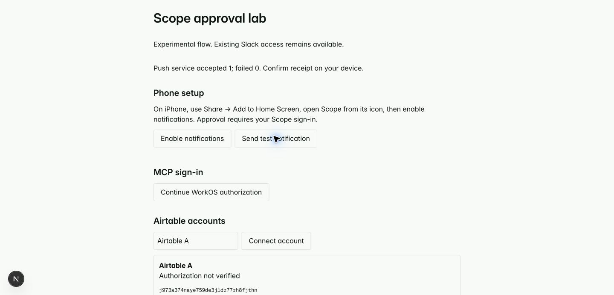

# Scope approval experiments

Experimental branch: `codex/scope-approval-prototypes`, based exactly on cleanup commit `9ac1df0`. The cleanup is [PR 48](https://github.com/nishilfaldu/scope/pull/48), targeting main and left unmerged. These experiments add `/lab` and separate probe tables; they do not replace the Slack flow.

## Evidence recorded October 3, 2026

| Experiment           | Observed result                                                                                                                                                                                                                               | Still unverified                                                                         |
| -------------------- | --------------------------------------------------------------------------------------------------------------------------------------------------------------------------------------------------------------------------------------------- | ---------------------------------------------------------------------------------------- |
| Cleanup baseline     | 95 tests, typecheck, lint, formatting and Next build passed before commit/push                                                                                                                                                                | Human PR review and merge                                                                |
| Prototype boundaries | 104 tests passed, including JWT signature/issuer/audience/expiry checks, ownership, requester binding, independent account approvals, conflicting retries, denial, acquisition leases, revocation during acquisition and shared-token history | Real WorkOS-issued tokens                                                                |
| Private local helper | Three fixture checks passed: only fixed Airtable endpoints receive provider bearer credentials; pending retries retain the key; wrong account, expired grant and credential echo fail closed                                                  | Actual Airtable API token via Connect                                                    |
| MCP wire timing      | Installed helper launched through the official MCP SDK; 10-second and 90-second approvals completed, and a 60-second client timeout recovered after approval at 90 seconds with the same key; no duplicate request                            | An ordinary Codex desktop chat waiting on this tool, followed by physical-phone approval |
| Native Codex plugin  | `codex plugin add scope-local@scope-prototypes` succeeded. Codex app-server MCP discovery launched `scope-local` and listed `airtable_list_bases` without an error                                                                            | Public marketplace distribution and tool invocation from the existing desktop chat       |
| Push                 | Chrome permission granted; subscription saved under the signed-in owner; test push service accepted 1, failed 0                                                                                                                               | Device receipt, notification tap, iPhone Home Screen installation and approval           |
| Airtable OAuth       | Connect connector created and attached only to development + preview. Authorization reached Airtable and failed before consent                                                                                                                | Two distinct accounts, API access, expiry and provider revocation                        |
| WorkOS staging       | Dashboard reached sign-in; integration code and cryptographic fixture checks are ready                                                                                                                                                        | Staging credentials, resource/client configuration and live sign-in                      |

The MCP timing test uses a local HTTP fixture with synthetic credentials. It proves protocol timing and retry behavior, not a live Connect/WorkOS/phone round trip. Native discovery started no model conversation and is not a custom agent launcher.

## What stopped the Airtable test

Vercel CLI 62.1.0 lists Airtable's MCP connection as OAuth with automatic client registration or a supplied client ID/secret. Its API connection is a personal access token. A PAT is not an expiring OAuth substitute for this experiment.

The experimental connector is `airtable/scope-airtable-probe` (`scl_KMH4VGLP3ARUsbPme4mDwQ`), linked to the `scope` project in development and preview only. The managed MCP authorization produced:

> invalid client_id or mismatched redirect_uri

The request used the connector URL as `client_id` and `https://connect.vercel.com/callback` as its redirect URI. No provider token was acquired. A registered Airtable OAuth client is the next gate. Supplying that client may fix authorization; it does **not** yet prove an MCP-scoped token works with Airtable's REST API.

After configuration, connect account A and account B separately in `/lab`, switching the Airtable login as needed. Each connection attempt gets a distinct Connect subject. Verify both with `/v0/meta/whoami`; require different provider user IDs and stable installation IDs. Then request each account separately and check that the local helper returns that account's bases. Revoke A, confirm that further A delivery fails, and check B independently. Test a previously issued A token privately against Airtable after revocation; never print it or return it to the model.

The server calls `getTokenResponse` with the selected subject and installation, requests refresh, and rejects absent/non-finite/near-expired expiry. It preserves the provider's returned expiry instead of inventing a Scope lifetime. Connect holds refresh credentials. Scope stores only encrypted access credentials for retry recovery and a keyed fingerprint for history grouping. The local helper keeps provider access tokens in process memory only.

`revokeToken` is called for the exact selected subject/installation after Scope blocks future delivery. API success is reported separately from the local block. Previously issued bearer validity remains provider-dependent; no successful live Airtable revocation has been observed. See [Connect token semantics](https://vercel.com/docs/connect/concepts/tokens) and [SDK reference](https://vercel.com/docs/connect/sdk-reference).

## WorkOS setup, retaining Convex login

[Standalone Connect](https://workos.com/docs/authkit/connect/standalone) lets Scope authenticate users with its existing Convex email-OTP flow. Configure a staging WorkOS environment, then set:

- `WORKOS_API_KEY`: server-only staging secret.
- `WORKOS_ISSUER`: exact HTTPS AuthKit issuer origin, without a trailing slash.
- Login URI: `<scope-origin>/lab`.
- Resource identifier: `<scope-origin>/api/probe/mcp`.
- A public OAuth client for the local helper, with redirect URI `http://127.0.0.1:47831/callback` and authorization-code/PKCE support.
- For Codex remote MCP sign-in, enable the registration method supported by the client (WorkOS documents CIMD and optional dynamic registration).

Scope completes `external_auth_id` only after its own authenticated session, using external identity `scope:<Convex user ID>`. Resource requests verify the WorkOS JWT's signature, issuer, audience, expiry, subject, client ID and consent/session ID. The server retrieves the [WorkOS user](https://workos.com/docs/reference/authkit/user) and maps its `external_id` back to the existing Convex owner. Requester IDs are derived from verified claims; tool arguments cannot nominate another owner.

The requester displayed in the approval is `sub:client_id:sid`. This identifies an authenticated OAuth user/client/consent. It does **not** distinguish two chats sharing the same OAuth consent. Unique cryptographic identity per agent/chat needs separate client credentials or another attested identity design.

WorkOS publishes free staging access to all products, AuthKit free through one million monthly active users, and an optional custom domain at $99/month. No payment blocker was observed. This is not a quote for every possible Connect feature or production usage; confirm the desired production configuration in the dashboard. [Published pricing](https://workos.com/pricing).

## Local plugin installation and login

From this checkout:

```sh
codex plugin marketplace add "$PWD" --json
codex plugin add scope-local@scope-prototypes --json
```

The dependency-free Node helper lives in `plugins/scope-local`. The plugin sets its working directory to its installed root, so `node server.mjs` resolves after Codex copies the plugin to its cache. This was verified with native MCP discovery. Node 22 or newer must be on the host PATH. There is no npm lifecycle installation requirement.

Create `~/.config/scope-probe/config.json` privately (`0600`, parent directory `0700`) with:

```json
{
  "origin": "https://YOUR-SCOPE-PREVIEW",
  "issuer": "https://YOUR-WORKOS-ISSUER",
  "clientId": "YOUR-PUBLIC-OAUTH-CLIENT"
}
```

Run `node plugins/scope-local/login.mjs` locally and open its sign-in link. This performs loopback authorization with PKCE and saves the **WorkOS** access credential in that private file. It never saves a provider credential. The login prototype does not retain refresh tokens; repeat login when the WorkOS access credential expires. Do not paste access tokens into chat or tool arguments.

Once the installed plugin is loaded by a Codex chat, invoke `airtable_list_bases` with the account ID shown in `/lab`, a reason, and a random 16–128-character key containing letters, numbers, underscores or hyphens. Preserve exactly the same key/account/reason on retry. Example non-secret arguments:

```json
{
  "accountId": "ACCOUNT-ID-FROM-LAB",
  "reason": "List bases for this task",
  "key": "unique-request-key-123456",
  "waitSeconds": 90
}
```

The helper privately requests approval, waits, retrieves an approved access token over authenticated HTTPS, checks Airtable identity locally, and calls Airtable locally. Successful tool output includes only selected base data and account/expiry metadata. It never exposes a token retrieval MCP tool. Errors are generic, stderr stays empty, and the fixed Airtable URLs reject redirects. Provider content is still untrusted data.

The remote endpoint `/api/probe/mcp` is a separate WorkOS OAuth/approval-status experiment. Its `request_approval` tool never retrieves or returns a provider credential. A remote Codex OAuth consent and the separately registered local helper client have different requester identities; their approval IDs cannot be interchanged. Use the local helper for the end-to-end provider-data experiment.

Local install is proven. Public distribution is a separate gate: OpenAI's [plugin packaging documentation](https://developers.openai.com/plugins/build/plugins) distinguishes local testing from supported submission paths; local-only MCP submission requires the documented OpenAI support path rather than assuming arbitrary local commands are accepted publicly.

## Phone and timeout test procedure

HTTPS preview: [Scope approval lab](https://scope-nfltfn2kz-nishil-faldus-projects.vercel.app/lab). Vercel reported `READY`, target `preview`, build command `pnpm build`, with a 300-second MCP function limit. The deployment explicitly uses the development Convex URLs and probe secrets. WorkOS environment fields are still absent, so live MCP authorization cannot complete yet. Existing Vercel preview protection may require signing in before Scope's own sign-in.

The development backend is `bright-dinosaur-692`. The frontend lab runs locally at `http://localhost:3001/lab`; use the HTTPS preview recorded below for a physical phone. The preview build uses `pnpm build`, not `convex deploy`. Probe server code refuses Vercel production execution. Existing production flows are not a substitute test target.

1. Open the HTTPS preview on iPhone, sign in using the existing Scope flow, add it to Home Screen, and launch it from the icon.
2. Tap Enable notifications, grant permission, and send a test notification. Confirm actual device receipt separately from server acceptance.
3. Start the local tool call in an ordinary Codex chat. On the phone, inspect the requester, exact account and reason; approve. Confirm the waiting chat receives provider data, with no bearer credential visible.
4. Repeat with a delay longer than the client's tool timeout. After the user sends another message, retry with the identical key. Verify the same request/credential is used. No idle wakeup is required.
5. Deny another request; try a different signed-in owner; revoke during acquisition. Each must fail without delivering credentials. Inspect one history accordion per unique token and its recipient list.

The request lifetime is 30 minutes, acquisition lease 30 seconds, helper/server wait at most 240 seconds, and remote route maximum duration 300 seconds. These are implementation bounds, not a promise that a host will wait that long. Lost responses recover the stored encrypted credential until the approval or provider token expires.

## Checks and remaining limits

```sh
pnpm test
pnpm exec tsc --noEmit
pnpm exec eslint .
pnpm build
node --test prototypes/helper.check.mjs
SCOPE_INSTALLED_HELPER=/absolute/installed/plugin/server.mjs node --test prototypes/mcp.check.mjs
```

This is a development experiment, not launch-ready replacement infrastructure. History is bounded to the latest 100 rows and has no retention/purge job. Push sends have no durable retry queue or expired-subscription cleanup. Token deduplication is per account. JavaScript clears references after a local call but does not guarantee secure memory zeroing. A canceled call may have already finalized a credential, which is why retry is idempotent. Provider refresh/rotation behavior, live revocation, physical-phone receipt and ordinary Codex chat completion remain live verification gates.

Private setup files are ignored by Git and Vercel uploads. `SCOPE_PROBE_SECRET` is shared only between the prototype server and development Convex deployment; `SCOPE_PROBE_TOKEN_KEY` is the server's AES-GCM key; VAPID private material remains server-only. No WorkOS or Airtable provider secret is committed.


