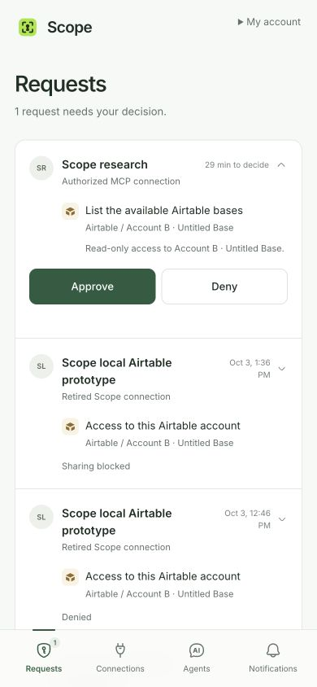
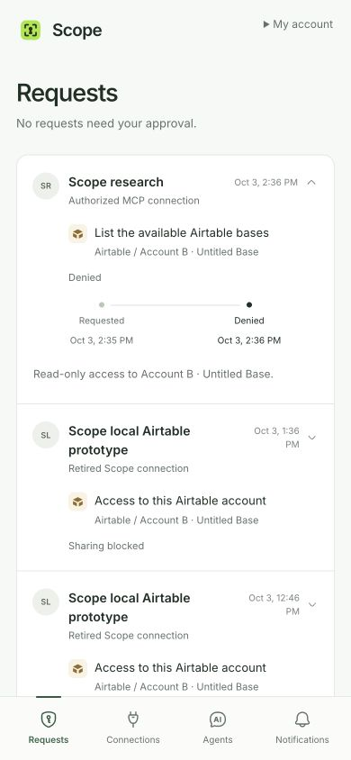
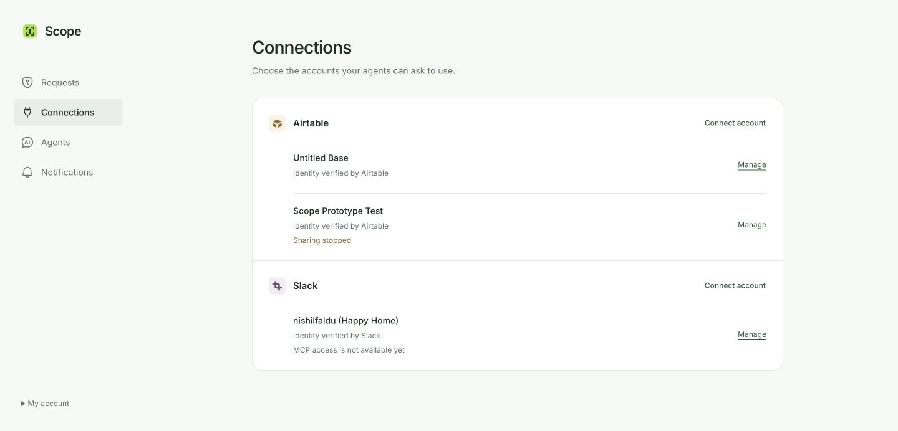

# Live Scope implementation review

The approved design now uses real data on the single shared checkout and `codex/scope-approval-prototypes`. Draft PR 49 remains stacked on PR 48, without a merge or production deployment. The branch preview is https://scope-preview.vercel.app; its backend is `dev:bright-dinosaur-692`.

## Automated validation

86 Vitest tests pass, along with ESLint, TypeScript and the optimized Next.js build. Seven helper checks cover private credential use, exact Airtable endpoints, two-base isolation, receipt/retry behavior and rejection of retired direct credentials before network IO. The protocol check passes a real 90-second stdio wait, caller timeout and same-key retry. PR CI also passes.

New checks cover owner/browser/expiry fencing and idempotency of OAuth completion; provider failure before any PAT write; old pending requests behind more than a page of completed history; secret-free live retained decisions; saved MCP names; stopped recipients during acquisition; and refusal to transfer legacy approvals to a new MCP recipient.

The old dev `/api/agent-connections`, `/api/access-requests`, `/api/credentials`, `/api/claim` and `/api/slices/revoke` endpoints return 404. Obsolete scheduled expiry jobs were retired before their functions were removed. Archived legacy data remains outside the active schema.

## Actual Chrome and helper checks — October 3, 2026

Checks used the owner's existing normal Chrome profile through CUA. No isolated browser profile, fabricated provider identity, or provider credential in tool output was used.

A real WorkOS PKCE sign-in reused the existing client, identity permissions and consent. The token was saved privately, with legacy fields removed from the standard helper config. The short-lived first token expired during deployment and was correctly rejected; a fresh sign-in completed the checks. Chrome blocked the local callback page, but the local exchange had already succeeded. No browser security warning was bypassed.

The remote MCP initialized, listed `request_approval`, and reused actual request `k57306shb4tppj9b83rnxrpvh98fkvr2` with key `mcp-ui-review-20261003-01`. The private helper returned `pending` for the same request without a credential. The UI showed its human intent, the owner-saved name and the read-only B boundary. Denial stayed in the same row and added its real timeline milestone. Both the updated helper and native Codex `airtable_list_bases` subsequently returned `denied` for that same request with no credential. Wrong-origin calls with a live signed token return 403; missing, retired-header and retired-Bearer calls return 401.

The MCP name was temporarily changed to Scope research. Existing and new requests followed that name. It was restored to its original MCP connection after the test. No authorization was expanded.

The connection chooser offered only the two configured read-only bindings. Cancellation left the displayed accounts unchanged. Re-verifying active B reused its existing account ID and returned Airtable's actual Untitled Base name. A remains blocked; its PAT was not revoked or re-enabled. The visible list remains two Airtable accounts and the existing Slack account. Unverified historical setup rows are excluded.

Airtable OAuth still fails upstream with `invalid client_id or mismatched redirect_uri`. Returning from that failure left the account list unchanged. The temporary attempt expires independently; it is not an account. Fixing the registered Airtable client/redirect is an upstream setup dependency. Slack is explicitly labeled as unavailable for MCP access, while its existing account sign-in and management remain.

At a 390 × 844 viewport, page width is exactly 390 px and both decision buttons are 44 px high. Navigation moves to the bottom. The real notification screen offered Enable notifications and did not claim this browser was subscribed or show a test action without a saved subscription. No permission prompt or test push was sent in this run. Desktop sizing was restored afterward.

Final visual cleanup removes an empty pending expansion, unused sample-review styles, and transient null text while a connection dialog closes. Stopped MCP connections use their recorded stop milestone; their timelines cannot keep waiting or invent an expiry after sharing was stopped.

## Limits of this evidence

The positive WorkOS/PAT delivery, independent A/B approvals and iPhone notification receipt described in the historical experiment log predate this UI rollout. This run adds current live MCP/request/denial/native-helper and binding-verification evidence; it does not fabricate a fresh positive provider-delivery approval. The credential path and its race/security checks remain tested.

Physical iPhone installation/push receipt, native remote-client OAuth, and Airtable OAuth provider refresh/revocation remain separate tests. Local stop sharing never claims provider revocation. Receipts do not establish completed work. No unrelated provider tool was added.

