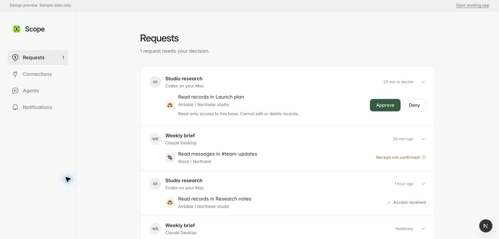
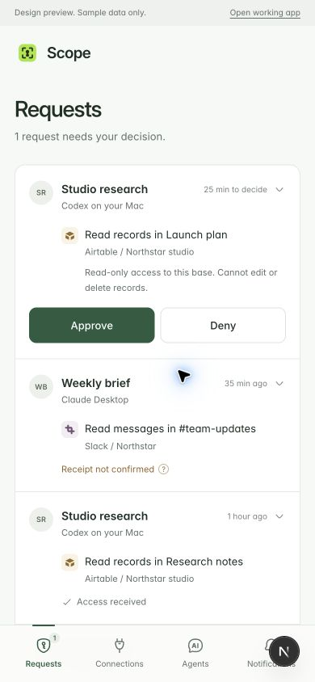
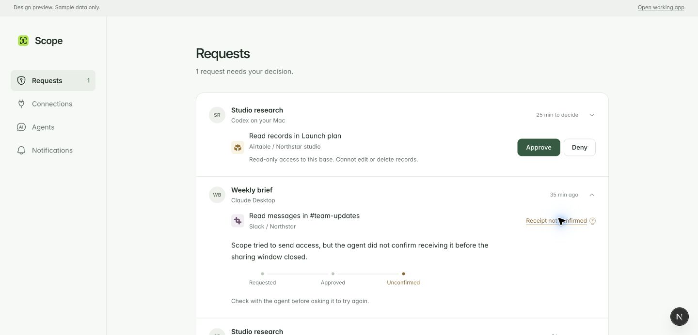
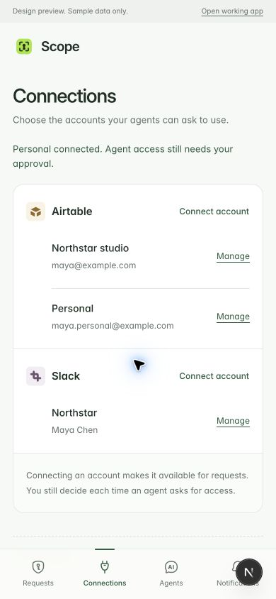
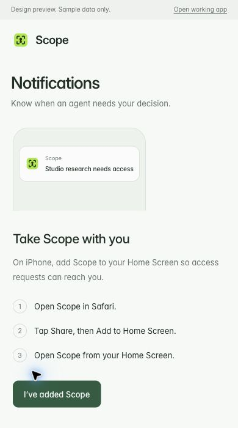

# Scope: a quiet access inbox

## What the person is trying to do

On a phone, a request interrupts something else. The first view must answer who is asking, which account, and what access is involved. The decision belongs beside that information. The person should not have to expand a technical timeline to judge an approval.

On desktop, the person is usually returning to understand an outcome. The same request becomes a quiet record. Its expanded view should answer the question raised by its current state: did the agent receive access, is something still waiting, or did the opportunity end? Approval and receipt remain separate facts. Successful work is outside Scope's evidence.

Connecting an account is a sign-in journey, not a form for creating database records. Provider-returned identity becomes the account after success. Closing or failing sign-in leaves the account list unchanged. Reconnecting a previously valid account is distinct from an incomplete first attempt.

## Direction and tokens

Keep the existing Inter typeface: 28 px page title, 15 px requester/action text, 14 px supporting text, 12 px quiet times. The intent is continuity with Scope and easy reading, not a cosmetic rebrand.

Palette: paper #F7F9F7, surface #FFFFFF, ink #1D3025, quiet text #647168, divider #E3E9E3, evergreen #285C40. Scope's existing lime mark remains recognizable; decision buttons use evergreen for contrast and restraint. Amber text is reserved for outcomes needing explanation. No decorative gradients, shadows, colored status pills or metric cards.

Desktop: a narrow navigation rail and one comfortable reading column. Records have a shared surface and dividers. On a phone, navigation moves to the bottom and action targets grow; the information hierarchy remains the same.

    Desktop                         Phone
    Scope | Requests                Scope
          | 1 request needs you     Requests
    Requests                        1 request needs you
    Connections | Agent + source    Agent + source
    Agents      | Account + access  Account + access
    Alerts      | Approve  Deny      Approve        Deny
                | Quiet record      Quiet record
                | Expanded outcome  Expanded outcome
                                    Bottom navigation

The memorable element is the request itself: a named agent asking for a concrete kind of access to a recognizable account. Provider marks identify accounts; agent initials identify saved connections. Neither is decoration.

## Critique before building

A dashboard of cards and badges would still make the person scan a report. An always-visible timeline would still privilege system activity over a decision. The chosen approach uses one list, no lifecycle tabs, no duplicated summary inside an expansion, one summary time, and short evidence only when requested. The expansion starts with what the current outcome means rather than exposing database stage names. Desktop decision buttons stay modest; mobile controls stay comfortable.

Notifications are an optional setup journey, not a dashboard of transport states. Agent naming belongs with the source connection, with clear limits: a chosen name is not proof of a particular chat. Connections share the same app/account pattern for Airtable and Slack.

## Review boundary

`/design-review` is an authenticated, development/preview-only interactive implementation. All identities, records, connection callbacks and notification permissions are sample states. There are no backend mutations, credential requests, provider sign-ins, notification grants or persistent browser writes. Refresh resets the example. The real app routes and security implementation stay intact.

The small implementation tests these journeys: approve and wait (never automatically receive), deny, inspect received access, explain an unconfirmed receipt, stop future sharing without claiming provider revocation, cancel a connection without creating an account, connect using returned identity, rename an agent connection and walk through phone notification setup. A separate review control changes the first request's example state; it is not proposed product UI.

## Tradeoffs and rollout questions

The design hides raw identifiers, delivery counts and diagnostic reasons. It still shows access scope and source connection because those change the user's decision. Technical evidence remains in the existing backend, not a new logs feature.

The prototype deliberately uses truthful, human-readable scope and identity fixtures. Live adoption needs a structured provider identity returned only after successful binding, a safe human intent field distinct from existing test reasons, stable agent display names, and explicit evidence for every outcome. This review does not fabricate those fields from raw IDs or silently change OAuth/account semantics.

The pending decision is visually prominent in one shared list. The prototype keeps its place when decided so the person can see what changed. A rollout needs a considered pagination/sorting policy rather than promoting only the first loaded page's pending rows.

## Review evidence

Interactive review: `http://localhost:3000/design-review`, mirrored at `https://scope-preview.vercel.app/design-review` after the branch deployment. Use the four navigation items, open a request, approve or deny the first example, and use “Try the design” to switch its moment or reset. These are review controls rather than proposed account settings.

Computer-use checks in Chrome covered the 390 × 844 phone viewport and the normal 1440 px desktop viewport. Phone decisions measured 44 px high; the page width remained 390 px without horizontal overflow. Approval kept five requests and left the first one waiting. Denial changed that same row. Renaming Studio research to Launch research updated its request identities. Stopping a received request preserved its receipt milestone and clarified that previously received access was unaffected.

A failed example sign-in followed by cancellation left only the two initial accounts; completing the same example added Personal using the returned sample identity. Notification refusal kept the request navigation available. The desktop success example completed without asking for an actual browser permission. A viewport is not a physical iPhone installation test.

Visual critique removed the repeated approval banner from the request list, moved access limits before the phone decision buttons, and shortened the expanded lifecycle from a report of system operations to a few meaningful milestones. Sending uncertainty remains in the outcome explanation. Desktop notification setup skips the phone installation steps.

